# Known gaps

Major gaps and errors found during development that were judged too complex or too
time-consuming to fix when they were found, and remain to be fixed. Each entry says what
fails, how to reproduce it, the evidence, what was tried, and why it was left. Remove an
entry when it is fixed (the commit fixing it says so).

Each entry's figure is drawn from its repro by `tools/gap_figures.py` (two are sketches, and
say so): what kentron builds wrongly is marked in red, and what it fails to build is dashed.

Smaller differences on the public corpus are tracked by the corpus runs themselves; this
log is for the root causes behind them that need real work.

## Fillets

### Chamfers of constant throat where the faces' angle varies along the edge

*Found 2026-11-09.*

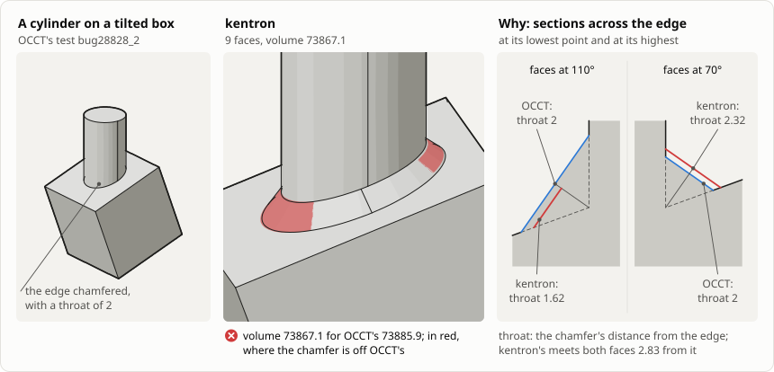

OCCT's throat chamfers (`chamf_throat`, and `chamf_throat_with_penetration`, whose section
is a right-angled triangle with its apex `offset` inside a face) keep the throat constant
along the edge, so where the faces' angle changes along it, the distances along the faces
change too. kentron has no such chamfer: the DRAW commands turn the throat into two
constant distances, from the section at the edge's middle. That is exact where the angle is
the same all along (planes; a cylinder or a cone on a plane square to its axis: OCCT's
`bug28828_1`, `_8`–`_14`, `_17`–`_20` pass) and wrong elsewhere.

- **Repro:** OCCT's `tests/bugs/modalg_7/bug28828_2`, `_7` (a cylinder fused to a box
  tilted by 20°: the section is an ellipse), `_4` (two crossing cylinders), `_15`, `_16`
  (a box cutting through a cylinder: the edges end on the box's side).
- **Evidence:** volumes 73867.1 (OCCT 73885.9), 73772.4 (73900.4), 46677.8 (46724.8),
  50761.7 (50822.7); `_16` needs `explode` of a compound in OCCT's order of the
  generated edges.
- **Needed:** a chamfer whose distances along the faces are solved at every section from
  the throat (OCCT's BlendFunc_ConstThroat and BlendFunc_ConstThroatWithPenetration), not
  given; kentron's chamfers are built from distances. About a day's work.
- **Also:** on NURBS faces, kentron's chamfer of constant distances is not exact: `_6` (a
  NURBS-converted cylinder on a plane) gives 73604.55, where Pappus gives 73604.344 for the
  triangle revolved, and kentron gets 73604.344 on the same faces unconverted. (OCCT's
  test expects 73604.1, and OCCT 8.1's DRAW gives 73670.6.) `_21` (a NURBS cone) is off
  by 4.4 in 446 298.

### A top loop filleted by more than the rounds it runs over

*Found 2026-11-22.*

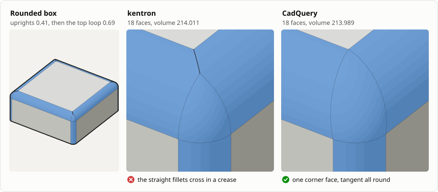

A prism whose outline has rounded corners of radius ρ, its top loop (one tangent chain of
lines and arcs) filleted by r > ρ: no ball of radius r rolls round an arc of radius ρ
square to it. kentron rounds the straight runs as cylinders and each corner arc as a short
surface of revolution, and the two cylinders at a corner run on past it and cross: a crease
along the corner's diagonal (0.06 to 0.56 rad), with no tangent plane along it, which
`fillet` must not leave. OCCT's corner is smooth (its worst turn between neighbouring
normals, 0.047 rad, stays put as the spacing goes from 0.017 to 0.002: an approximation's
kink, not a crease).

- **Repro:** the figure's script, or the conformance suite's
  `fillets/top-loop-bigger-than-corner-rounds` (2 of its 20 cases pass; the others fail
  its no-crease check, by 5–8 creases or by 8–16 of about 400 scan points landing on the
  crease edges, with no normal).
- **Evidence:** on its case `227a…` (a pentagon, ρ 0.842, r 1.720) OCCT 8.1 gives volume
  564.896, area 404.868, one B-spline face at each corner from the top down to h − r; kentron
  565.150, 405.320. Under gdb, OCCT's `blend` there runs `PerformSetOfKPart` (the lines'
  cylinders by `ChFiKPart`, truncated by `Trunc` short of the arcs) and then
  `PerformSetOfKGen`, walking the five corners (`PerformSetOfSurfOnElSpine`); none of the
  corner routines (`PerformOneCorner`, `PerformTwoCorner`, `PerformIntersectionAtEnd`)
  runs.
- **Needed:** OCCT's guideline over each corner: `ChFi3d_PerformElSpine` joins the spine's
  edges between the truncated cylinders into one B-spline, smoothed to C2 where it is not
  (`ChFi3d_ApproxByC2`: 101 points, `GeomAPI_PointsToBSpline` of degree 3 to 8), and the
  ball rolls along that curve, in its normal planes, between the top and the faces round
  the corner (`BRepBlend_ConstRad` walked across the faces' boundaries). kentron's rolling
  takes its sections square to an edge; this needs it along a guideline of its own, with
  `Trunc`'s extents for the cylinders. A few days' work.

## Offsets and shells

### A revolved profile's offset cut along its seam plane

*Found 2026-11-09.*

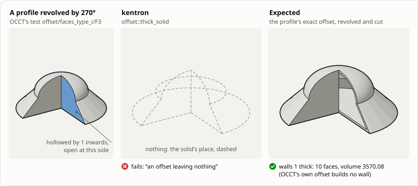

Partial solids of revolution whose side planes move off a pole or apex on the axis are
offset as the whole solid of revolution's offset cut by the side planes' moved
half-spaces (offset/revolved.rs): moving the faces one by one, keeping the topology,
cannot drop the pole. One case still fails: OCCT's `tests/offset/faces_type_i/F3`, an
ellipse-and-polyline profile revolved 270° and hollowed by 1 inwards, open at the side
where the revolution starts. The boolean cutting the offset revolution by the moved wedge
misses: swept from the open side (its seam on the plane cut along) it leaves the solid
whole; swept from the other, it leaves 11497.9 and an unsound solid, where the exact inner
solid is 9585.3. The thick solid then fails ("an offset leaving nothing").

- **Repro:** `tests/offset/faces_type_i/F3`; the same profile revolved 90° (`E8`) and
  cut by planes on the far side of the seam works.
- **Evidence:** the exact wall is 3570.082 (Pappus' theorem on the profile and its offset,
  the moved side plane integrated over the angle); OCCT builds no wall (its result is the
  source, in OCCT 8.1 too).
- **Tried:** sweeping the revolution from a profile turned into the middle of the turn
  the solid leaves out (seam away from both planes): the booleans then miss in other cases
  too (E8, shape_type_i A5).
- **Needed:** the boolean of the offset revolution (an offset surface of a surface of
  revolution) and a plane through its axis made reliable.
- **Also:** `faces_type_i/B5` (a 270° cone, both side planes removed, outwards) is 3.4e-5
  off the exact 282.0365: the moved cone face's area is 5e-5 too large.

### Wire offsets around a ragged end of tiny sharp turns

*Found 2026-11-09.*

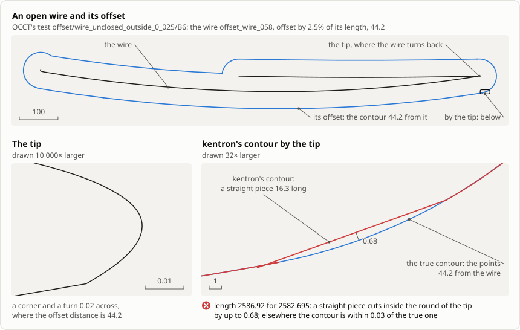

An open wire (one B-spline) ending in a cluster of tiny, sharply turning stretches (cut
at curvature extrema into pieces 0.02 long, curved tighter than the offset distance): their
offsets fan out into swallowtails crossing nearly tangentially, and the contour is not cut
where they cross. The parts closing the contour there pass a hair (3e-4 of the distance)
inside the round of a neighbouring point, so they were dropped and the offset was empty;
they are now taken where nothing else closes the contour, and the result is close but not
exact.

- **Repro:** OCCT's `tests/offset/wire_unclosed_outside_0_005/B6`, `_0_025/B6`,
  `_0_075/B6` (`offset_wire_058.brep` offset by 0.5%, 2.5%, 7.5% of its length).
- **Evidence:** the points within the distance (`tools/brute.py wire`, the wire sampled
  200 000 times) bound one loop of length 3316.33, 2582.695, 3127.914 (OCCT 3316.27,
  2582.56, 3127.75); kentron's 3316.78, 2586.91, 3142.06, its contour straying from that
  boundary at the ragged end (up to 0.69 at 2.5%) and lying on it elsewhere.
- **Needed:** the crossings of the swallowtails resolved there (where the raw contour's
  pieces cross nearly tangentially), or the envelope found as the boundary of the union of
  discs (as OCCT's medial-axis construction does).

### Sliver faces in shells found by distance

*Found 2026-11-08.*

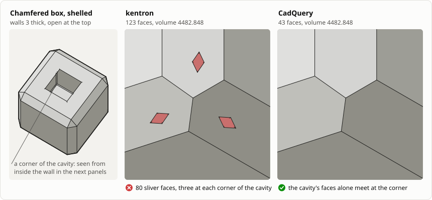

Shells and offsets that fall back on the points-within-the-distance construction
(`offset/within.rs`, used where faces vanish) have the right volume and are valid, but
their faces can come out split into thin slivers near the corners of the cavity.

- **Repro:** `box(20, 20, 20).edges().chamfer(2).faces(">Z").shell(-3)` gives 123 faces
  against 43 (volume 4482.848, exact), and a 60×40×25 block with vertical edges filleted 5
  and top edges filleted 2, `faces("<Z").shell(-3)`, gives 43 faces against 27.
- **Cause:** the cell containing the cavity leaks into the corner regions in thin slivers
  (about 0.015 thick) where the moved faces' sheets nearly meet. The slivers' faces lie on
  the right planes, folded back on themselves, and do not merge.
- **Tried:** deciding tiny cells by the neighbours they share faces with, and growing every
  planar sheet past its face. Neither changed anything.
- **Matters because:** selectors such as `faces(">Z")` on the result can pick up slivers.

## Features

### Extruding up to a curved face that not every ray meets

*Found 2026-11-08 (`anniedoris_synthetic_cadquery/docs_examples/example24.py`).*

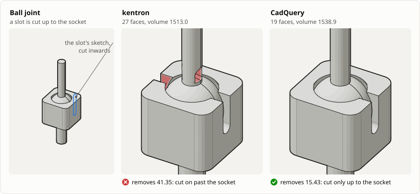

`cutBlind(face)` / `extrude(face)` up to a curved face (pykentron's `Solid.dprism`) splits
the profile's prism, extruded far, by the face's whole surface, and keeps the piece touching
the profile. Where some of the profile's rays miss the face, that piece runs on along them
for the whole length, cutting whatever it passes. OCCT cuts only along the rays that meet
the face (the face itself, as trimmed), up to it, and leaves the others alone.

- **Repro:** example24: a slot 2 wide from z −3 to 7 at x = 6, cut up to the spherical
  cavity's face (r 5, trimmed at the box's top, z = 3). kentron removes 41.35 (through the
  shaft above the box), CadQuery 15.43.
- **Evidence:** a Monte Carlo count of the solid's points along the slot's rays that meet
  the face, between x = 6 and it, gives 15.54 ± 0.09.
- **Needed:** the face's shadow on the profile's plane (its edges' projections and its
  silhouette), to keep only the rays meeting it; a face that rays cross twice (as here, a
  sphere) rules out sweeping the face back instead.

### Removing all the fillets of a rounded box

*Found 2026-11-07 (usd-brep's `TestSmRemoveFilletNurbsPlanes`, the `expect: not_done` case
`usd_brep::cpp_fillets::remove_fillets_of_a_nurbs_box`).*

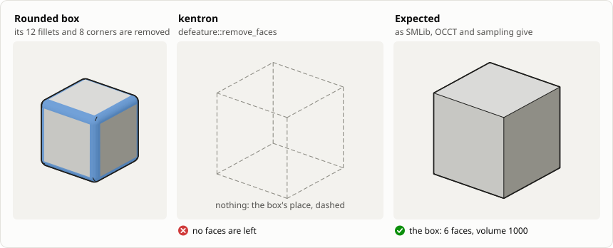

`defeature::remove_faces` of every fillet of a box rounded on all its edges leaves no faces,
where SMLib, OCCT and sampling all give the box back.

- **Cause:** all the fillets are one feature, connected at the corners, and `defeature.rs`
  carries the faces round a feature over it as cells: with the feature everywhere, there is
  nothing round it to carry.
- **Needed:** removing a feature that surrounds the faces it should extend.

## Booleans

### Gyroid lattice cells meeting at a corner

*Found 2026-11-08.*

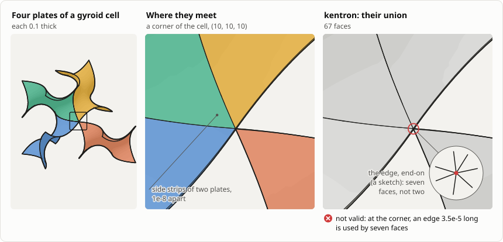

LatticeQuery's gyroid unit cell is a union of eight thickened plates, some a hundred-
millionth apart. The plates' pairwise unions are valid now (7d15022). The whole cell is
not: where four plates meet at a corner of the cell, their side strips meet 1e-8 apart, and
the union leaves an edge 3.5e-5 long used by seven faces.

- **Repro:** the plates `g000`, `g110`, `g001` and `g011` of `lq/topologies/gyroid.py`
  (see `test_gyroid_plates_a_hundred_millionth_apart` in
  `crates/pykentron/tests/test_against_cadquery.py` for building them), unioned in turn.
  The edge is at (10, 10, 10).
- **Evidence:** it is the same before 7d15022, which only exposed it (the self-crossing
  faces were reported first).
- **Also:** CadQuery's own unions of these plates are wrong: a brute-force count puts the
  first two plates' common part at 0.0024 ± 0.0004, not 0.18.
- **Needed:** coincidence handling for several faces within tolerance of one another at a
  point.

### Sweeps along separately fitted copies of one curve

*Found 2026-10-24; still failing 2026-11-08 (`jhnphm_spiral_lamp/lamp.py`).*

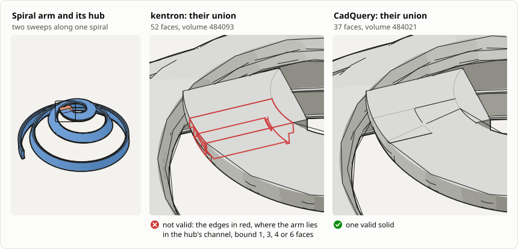

Two sweeps along B-splines fitted separately to the same parametric spiral, over
different ranges, have faces that should coincide but differ by 1e-9 to 1e-4 (the frames'
error times the 30 mm profile). Their union is not valid (52 faces against 37, with edges
bounding 1, 3, 4 or 6 faces where the arm lies in the hub's channel; 61 faces and 2 solids
when found), and the spiral lamp's later fillet fails on the invalid solid ("a fillet edge
must bound two faces, it bounds 4").

- **Tried:** a geometric test of partial coincidence (grid points with their feet inside
  the other face all within 1e-6). It catches only some pairs, and accepting 1e-4 would be
  unsafe. Reverted.

### Nearly coincident prisms with a seam inside a shallow crossing's band

*Found 2026-11-25.*

No figure: the error is a crescent 4.5e-5 in volume, too thin to see.

Two prisms on the same circle (radius 3, height 4), one moved across by 3e-6, cross at
two points at very shallow angles; within about ±1e-3 of the radius around each crossing
their sides are within tolerance of each other. With both circles' seams at 0° (away
from the crossings) every boolean is right (8adabf5, test
`prisms_on_a_circle_and_the_same_moved_a_hair` and its neighbours in `boolean/mod.rs`).
With both seams 30° from a crossing, the short face piece between a seam and the crossing
is sampled as lying on the other face, and the intersection comes out off by one crescent
(4.5e-5).

- **Repro:** the circle-prism test above with both prisms' seams turned to 30° from a
  crossing.
- **Needed:** classification of a face piece that lies within tolerance of the other
  face only over part of its length (decided from where it leaves the band, not from its
  samples). Not in brep-conformance.

### Twisted prisms passing through each other with the same section

*Found 2026-11-08 (`mryndzionek_cadquery_plaground/screw_cap_container.py`).*

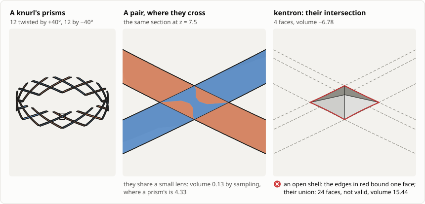

A knurl tool is the union of two sets of 12 triangular prisms extruded with a twist of +40°
and −40° (`placeSketch(...).twistExtrude`). A prism of one set and one of the other, whose
twists bring them to the same angle at some height, have identical sections there and pass
through each other in a small lens around it. kentron's booleans of such a pair are wrong:
their intersection comes out −6.78 (0.0022 from the same BREPs in Rust), and the union of
the two sets is invalid with 224.4 of volume, against 103.9 for the two sets apart. So the
knurled cap is cut to 252 of volume, invalid, against CadQuery's 4804.

- **Repro:** `knurl()` in the script's `util.py` with height 10, radius 26.75, cut angle
  120, depth 0.5, twist 40 and 12 prisms. The smallest case is two prisms: the one starting
  at −60° and the one at 0°, which coincide at z = 7.5.
- **Evidence:** their section is a closed network of 9 edges about 1 long round the
  coinciding section. CadQuery calls the pair touching (common volume 0, distance 1e-15),
  but its own union of the two sets is empty, so it is no reference either. Points sampled
  inside both prisms give the lens 0.1305 ± 0.0003 of volume, where a prism's is 4.33.
- **Needed:** handling of faces that coincide only along a section (a curve of tangency
  sweeping through), on B-spline ruled surfaces.

### Mirrored free-form faces meeting the mirror plane almost square

*Found 2026-11-08.*

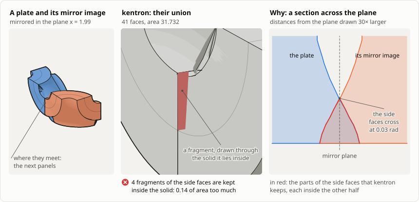

A union of a solid with its mirror image, where a free-form face meets the mirror plane at
nearly a right angle, keeps fragments of faces inside the other solid. Their intersection
curve lies in the mirror plane, and there the face and its mirror image cross at only 1e-2 to
1e-3 rad.

- **Repro:** LatticeQuery's `lattice_scripts/hetero-shwarz.py` (one Schwarz-P cell, size
  3.98, thickness 0.9). Its first step is enough: `s000 = schwartz_p_000(0.9, 1.99)` (an
  `interpPlate` face thickened by ±0.45 and unioned) placed at (0.995, 0.995, 0.995), then
  `s000.union(s000.mirror("ZY", (1.99, 0, 0)))`.
- **Evidence:** the union's area is 31.732 on kentron (41 faces), against 31.589 from a
  brute force on kentron's own two halves (a fine mesh of one half, each triangle near the
  plane classified by OCCT against the other half). Classifying every face of the result
  against both halves finds four fragments, 0.036 and 0.034 of area each side, lying up to
  3.6e-3 inside the other half; that accounts for the whole 0.14 surplus. CadQuery's result
  is wrong there too (31.583, with 0.14 of face inside and some missing). The whole cell,
  after four more such unions, comes to 119.288 on kentron against CadQuery's 116.379. The
  volumes are within 0.1%.
- **Cause, as far as found:** the halves' offset faces (A0 and its mirror image B0) cross
  in the plane x = 1.99, along y from 0 to 0.094 near (1.99, y, 1.444). That stretch is
  nearly tangent; it ends at a point where the faces are tangent and a second, slanting
  branch of A0 ∩ B0 crosses it. `march::trace` does trace that branch in the plane: a
  318-point chain at x = 1.99, kept as a section, its tangent stretches at its ends.
  But `boolean::section` of the two faces yields only a 1.85e-5 piece of it at the
  corner. So the curve is lost after marching, where the traced sections are cut to the
  faces. Face A0 is then not split, and `clean_components` joins A0's regions inside
  and outside B0 into one group of 21. Its majority vote (Outside) then overrides the four
  regions classified Inside on their own.
- **Where it is lost (found 2026-11-08, later):** in `Graph::intersect_faces` the chain
  gets no vertices to cut it at. That needs one where it leaves the faces at (1.99, 0.094,
  1.442) and one at their corner, (1.99, 0.0002, 1.4449). At the first, the faces touch:
  the two crossings there (edge 1 of A0 meeting B0, and its mirror image meeting A0) were
  found 4e-5 apart, off the plane, so the chain passes each only near (`passes_within`'s
  `touching_across` case). Such a point is kept only when two arcs pass it, and here the
  slanting branch's arcs end 0.006 short, its touching stretch dropped. At the corner the
  two crossings lie about 1e-5 off the surfaces, so `passes_within` rejects them before
  any test. Tried: keeping a point passed only near once wherever the chain leaves either
  face there (its points just before and after it on opposite sides of a face's
  boundary). Both near-duplicate vertices were then kept at the same parameter, and the
  union came out invalid (volume 5.47 of 7.95). Kept neither.
- **Needed:** each such pair found as one vertex. The point where an edge and its mirror
  image cross the plane is an edge–edge crossing, better conditioned than either
  edge–face crossing: find it so, and have `share_vertices` merge the edge–face crossings
  near it. Likewise at the corner. Then the chain's near passes there can be kept (once
  each, where it leaves a face), and the corner's points need to be allowed off the
  surfaces by as far as the touching faces put them.

### Section edges under-report their tolerance

*Found 2026-10-23; not re-checked since (bug32945 still passes as it stands).*

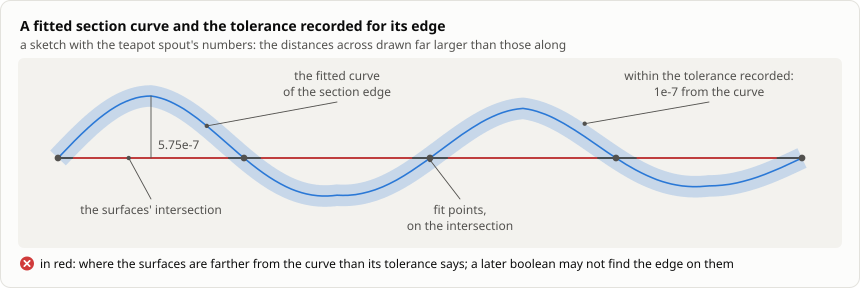

Fitted B-spline section curves stray from their surfaces between fit points by more than
the tolerance recorded for them (the teapot spout: 5.75e-7 against 1e-7), so a later
boolean may not find them on the surface.

- **Tried:** recording the true deviation by dense sampling. It is correct, but it fails
  OCCT's tolerance checks in bug32945 and buc60555_1, whose real gaps are larger.
- **Needed:** tighter section fitting, so that the true deviation is small.

### A cylinder ending just short of or past where it touches a torus

*Found 2026-11-25.*

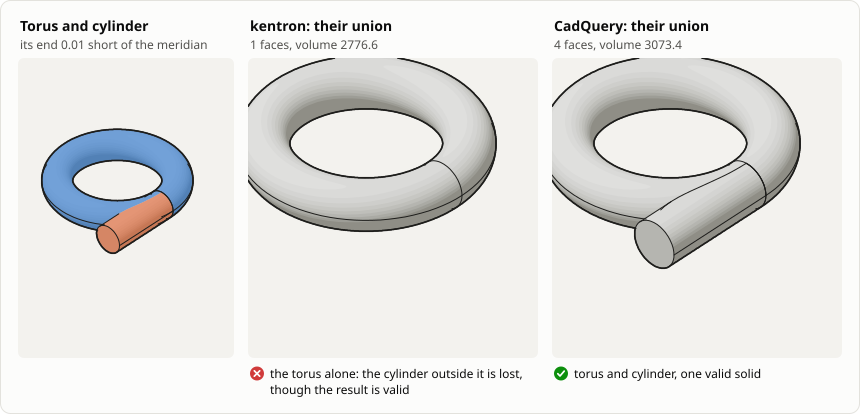

A cylinder of a torus's tube radius, its axis touching the torus's centre circle, touches
the torus along that meridian circle. With the cylinder's end exactly in the meridian
plane, or more than about 0.2 from it, booleans are right (eb48531). With the end between
about 0.01 and 0.2 short of or past that plane, its circle is not on the torus within
tolerance but crosses it at a very shallow angle, about s^2/(2Rr) for a shift s
(1e-6 to 1e-3 rad). The crossing vertex snaps to the cylinder's seam vertex, about 2e-4
from the true crossing, and the thin crescent of the end disc between its circle and the
section (at most 5e-4 wide) is lost when the face is split.

- **Repro:** torus R 12.8, r 3.315 about Z at height 3.7227; a cylinder of radius 3.315
  along -Y through (12.8, *, 3.7227), length 16.885, its end at Y = -0.01 (`scene_meridian`
  in `tools/gap_figures.py`).
- **Evidence:** union 2776.558, valid, where the volumes give 3073.43 (CadQuery 3073.428):
  the torus alone. The common part and the difference have the right volumes (286.076,
  2490.483) but are invalid; at shifts of ±0.1 all three are invalid with the right
  volumes. In the tube-and-shell cases of the same fix, B, C and D fail in this band, A
  and E pass; B's common part at -0.01 comes out empty against 35.1.
- **Needed:** vertices at shallow crossings placed at the true crossing rather than snapped
  to a nearby vertex, and face splitting that keeps slivers thinner than the snapping
  distance. Not a contained change.

### Parts within tolerance of touching along a torus and a cylinder

*Found 2026-11-25.*

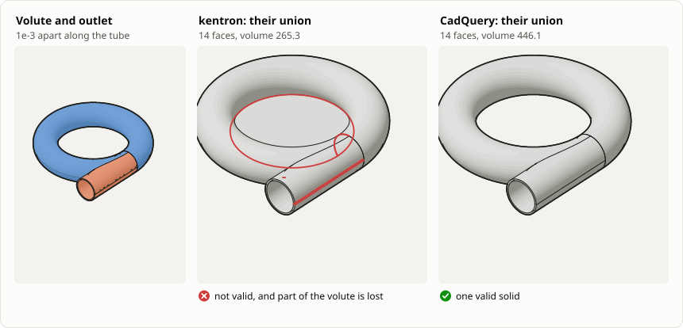

A compressor housing's outlet (a tube shelled from a cylinder of the volute's tube radius,
cut by the inner torus) and its volute (the top of a torus shell, cut by the cylinder)
touch along pieces of the inner torus and of the cylinder; touching exactly, they are right
(f56f435). Moved a little apart or into each other, booleans go wrong where the surfaces
are within tolerance of each other without coinciding: where the volute's flat bottom
(z = ro/2) meets the cylinder, the torus's section circle is tangent to the cylinder's
straight line and stays within 1e-6 of it for |y| < 4.5e-3, so an outlet end vertex at
y = -1e-3 lands on both and the split circle edge is taken the long way round (a disc face
of area 327); with the outlet's end 1e-3 into the volute, the tube's end lies where the
cylinder and the torus are within tolerance (y^2/2R < 1e-6).

- **Repro:** `~/prj/kentron-local/compressor/shifted.py` (`scene_outlet` in
  `tools/gap_figures.py`): R 12.8, tube radius 3.315, wall 0.3377, outlet moved by ±1e-3
  along its axis.
- **Evidence:** outlet 1e-3 away: union 265.30 and invalid where the parts' volumes give
  446.07 (CadQuery 446.0717), volute − outlet 174.85 and invalid (355.6). Outlet 1e-3 in:
  outlet − volute invalid (90.48; CadQuery 90.454). Moved 0.1 into the volute along the
  tube, or 1e-3 across it, 1e-3 up, 0.1 down: also invalid or wrong, on main before
  f56f435 too. The Rust-built operands pass the 1e-3-away case; CadQuery's revolved tori
  (not free-form, but met along traced sections) fail it.
- **Needed:** handling of surfaces that are within tolerance of each other near a boundary
  without coinciding (vertices and edge splits decided consistently on both), not a
  contained change.

### The part of a whole plane outside what it meets

*Found 2026-11-22.*

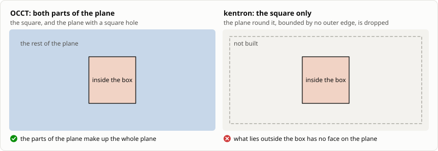

A face without edges on an unbounded surface (a whole plane, as
`BRepBuilderAPI_MakeFace(gp_Pln)` or `make::whole_face` makes), split by a section loop,
has a bounded part inside the loop and an unbounded part outside it: the plane with a
hole, bounded by no outer edge. `BOPAlgo_BuilderFace::PerformAreas` makes the second from
the loops left over as holes ("unused holes" added to a face on the whole surface, where
the face's box is open). kentron's `split::split_face` builds regions
only from an outer loop, so the hole loops are dropped and only the part inside is built.
Splitting a solid by such a plane, and the common part and difference of a solid and the
half-space of one, are right (they use only the part inside); what keeps the outside part
is not.

- **Repro:** `cells(&[block, half_space(whole plane)])` for a 2 x 2 x 2 box and the plane
  z = 1 (see `a_box_with_a_half_space_of_a_whole_plane` in `boolean/cells.rs`): the cell
  of the half-space outside the box comes out with no face on the plane, its volume -3.85.
  `cells(&[block, whole plane])` has no cell for the plane outside the box. A union of the
  box and the half-space is broken the same way, and a whole plane met by nothing (no
  loops at all, which `PerformAreas` keeps whole) is dropped.
- **Needed:** a region of holes only (no outer loop) on an infinite face, through
  `split_face`, the regions' interior points (outside every hole) and the faces built from
  them.

### Consecutive moves of a ball-end mill united where their end poses coincide

*Found 2026-11-26.*

No figure: the missing face is a lune of the ball a few hundredths wide, too thin to see
beside the moves' sweeps.

A ball-end mill (a half ball of radius 3 under a cylinder up to 30 above its tip) slid along
two consecutive aslant moves, the end of one the start of the next: `boolean::union` of
the two sweeps has the right volume (2587.896: the sweeps, 1704.61 and 1703.17, less the
tool at the shared pose) but leaves its shell open, and `union_all` of a pass's moves
refuses ("a union of closed shells left a shell open"). At the shared pose the first
sweep ends with the ball's half in front of its motion and the second starts with the half
behind its own: the two halves, split by the two moves' characteristic great circles (a
few degrees apart), overlap in a lune of the one sphere, where both sweeps' boundaries
coincide with the solid on the same side. The union keeps the circles bounding the lune
(on the first sweep's characteristic cylinder and the second's) and drops the lune
itself, its edges then used once each.

- **Repro:** the tool `sketch::profile` of [Start(0, 0), Heading(0), Arc { radius: 3,
  angle: 90 }, To(3, 30), To(0, 30)] on the xz plane, revolved about z; placed at (10, 4,
  f(10, 4)) and slid to (15, 4, f(15, 4)), and from there slid to (20, 4, f(20, 4)), with
  f(x, y) = −5 + 4 sin(πx/50) sin(πy/40) (brep-bench's cnc/ball-end-surface-raster, its
  pass at y = 4, moves 3 and 4); `boolean::union` of the two sweeps, then
  `validity::check`. The open edges are the arcs of the two characteristic curves at x ≈ 15
  from (15, 1, −1) and (15, 7, −1) down past the tip.
- **Evidence:** each sweep is valid; the union's volume is right; `union_all` of the
  moves refuses for each of passes 2 to 18 (passes 0 and 1, where the surface is level
  or nearly, unite), in pass 2 first at moves 3 and 4. The bench case also meets a sweep
  refusal of its own at pass 19 ("a point that does not settle on the curve").
- **Tried:** the characteristic great circle of the ball taken exactly (a circle, its
  pcurve fitted, so the first move's char sweep is an exact cylinder): the union fails
  the same way; and the second move's circle passes close to the ball's pole, where its
  pcurve is not fitted.
- **Needed:** the boolean's handling of faces of two operands on one sphere overlapping in
  a lune bounded by curves tangent to the other operand's faces (each characteristic
  cylinder touches the ball along its circle): the lune classified as on both boundaries
  with the solids on one side, and kept once.

## Sweeps of solids

### Turns whose copies of the tool touch on the axis

*Found 2026-11-26.*

No figure: `sweep::solid` has no pykentron binding, and the repro is a Rust test.

`sweep::solid` takes a turn about an axis meeting the tool: the tool's points on the axis
stand still, and its product (the body, `W` at the end and the sheets `W`'s boundary sweeps)
runs into itself round the axis, where it is split into pieces and the pieces it winds round
kept. Where the axis pierces a face at a point where the face's normal runs along it, every
copy of the face is tangent to the others there. A rod turned about a line square to it
through it is split right now (its volume within 3e-9 of brep-bench's reference); a cone
turned about a line through it, and a cube turned whole about its long diagonal (the three
edges at each corner on the axis sweeping one cone), are not: the split
(`boolean::enclosed_solids_at_once`) finds no pieces, or pieces whose volumes do not add up
to the product's. They are refused, not returned running into itself.

- **Repro:** `a_cube_turned_whole_about_its_diagonal` in
  `crates/kentron/src/sweep/solid/tests.rs` (accepting a refusal); brep-bench's
  `swept/cone-spun-about-a-line-through-it` ("a sweep running into itself, not split into
  pieces") and `swept/cube-spun-on-its-diagonal-inside-a-block`.
- **Evidence:** the cube's product is valid; its split finds pieces adding up to 33.517 of
  the product's 37.021 (brep-bench's swept void is 14.510). Before the planar side faces and
  finer overlap steps of e6005d4, the rod failed the same way (two pieces of 0.114 each,
  wound round twice, against a product of 42.237).
- **Tried:** exact elementary side faces; general surfaces of revolution instead (no change);
  splitting one sheet after another when the split at once fails (the same pieces).
- **Needed:** the split taking faces tangent at a point they all pass through, and several
  coincident cones from one corner; or a construction keeping the copies apart there (the
  tool cut by a plane through the axis, each piece's sweep made apart and united, which
  needs the union to take sweeps sharing faces on that plane).

## pykentron

### Solids from placed shells keep copies of their faces

*Found 2026-11-08 (CadQuery's `tests/test_free_functions.py::test_solid`, the one test of
its suite in `crates/pykentron/tests/cadquery_baseline.txt`).*

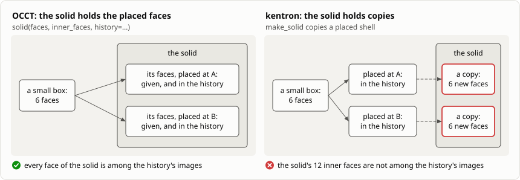

`solid(faces, inner_faces, history=...)` with inner faces of placed shells (boxes `moved` to
two places): the history's images do not include the solid's faces from the inner shells,
because those faces are copies, not the inputs.

- **Cause:** kentron's solids hold their shells unplaced (`make_solid` copies a placed shell),
  where OCCT's hold placed ones, so its solid's faces are the placed inputs themselves.
- **Needed:** placed shells in solids (a core invariant of the model), or a history whose
  images are not the inputs' own faces. Not worth it for this alone.
